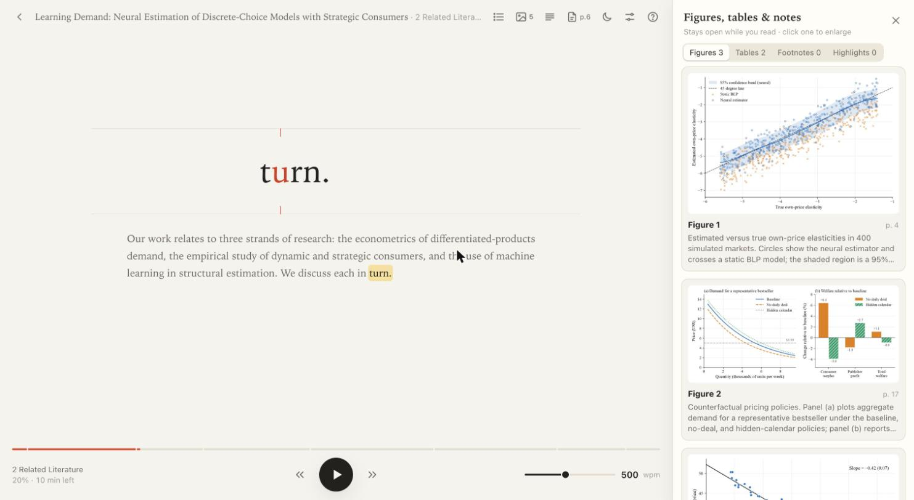

# A speed reader for PDFs

It runs entirely on your own computer. Nothing you read is uploaded anywhere.



It works with any PDF that has a text layer. I mainly use it for research papers, so that is what
the conversion is tuned for: two-column layouts, numbered sections, figure and table captions,
equations, footnotes and reference lists.

## What it does

- **One word at a time (RSVP).** Each word appears at the same spot with its focus letter marked,
  so your eyes stay still. Speed runs from 100 to 1000 words per minute and can be changed while
  reading. Sentence ends, commas, long words and numbers get a little extra time.
- **Figures, tables and footnotes stay within reach.** They sit in a side panel next to the text and
  can stay open while you read. When a sentence mentions "Figure 2", a button for it appears.
- **It stops where you need a moment.** At every new section, and at every displayed equation
  (shown as an image, with the paragraph that explains its variables), it waits for you.
- **Highlights and notes go back into the PDF.** Mark the sentence you are on, or attach a note to
  it; both are written into a copy of the PDF as a yellow highlight with a comment.
- **Automatic housekeeping.** Drop PDFs into a folder; they are converted and filed, and your place
  in each one is remembered.
- **A plain reading mode too.** The same document as clean scrolling text with a pacing highlight.

## Quick start

You need a Mac and [uv](https://docs.astral.sh/uv/) (`brew install uv`). Everything else is
installed automatically the first time, which takes about a minute.

```sh
git clone https://github.com/KustDavid/reading_tool.git
```

Then double-click **`start.command`** in the `reading_tool` folder. A Terminal window opens and the
app appears in your browser at <http://127.0.0.1:8377>. Close the Terminal window to stop it.

To look around before adding anything, open <http://127.0.0.1:8377/?mock=1> — a made-up demo paper.

From a terminal instead:

```sh
cd reading_tool/app
uv run python -m backend.server
```

## Adding PDFs

Either drag a PDF onto the app's library page, or put it into **`papers/inbox/`**. Conversion
starts by itself and takes a few seconds to a minute depending on length. Adding the same PDF twice
does nothing.

## Reading

Click a document, then press **Space**.

| Key | What it does |
|---|---|
| `Space` | Play / pause; continue after a new section or an equation |
| `←` `→` | Previous / next sentence (`⇧` for one word) |
| `↑` `↓` | Faster / slower, 25 wpm at a time |
| `[` `]` | Previous / next section |
| `F` `T` `Z` | Show or hide the figures, tables and footnotes columns of the side panel |
| `Enter` | Open the figure or table mentioned in the current paragraph |
| `H` | Highlight the current sentence (press again to remove) |
| `N` | Write a note on the current sentence |
| `C` | Contents |
| `M` | Switch between one-word-at-a-time and full text |
| `P` | Open the PDF at the current page, with your highlights |
| `D` | Light / dark |
| `?` | All shortcuts |

When paused, the surrounding paragraph is shown; click any word in it to jump there. The settings
button (top right) has font, size, words per flash, and how often reading should wait for you.
References, acknowledgements and appendices are skipped unless you turn them on in the contents list.

## Where your files are

```
reading_tool/
  start.command      double-click to start
  papers/
    inbox/           drop PDFs here
    library/         one folder per document
  app/               the program; nothing in here needs touching
```

Each folder in `papers/library/` holds one document: `original.pdf` exactly as you added it, the
converted text and images, your reading position, and — once you have highlighted something —
`annotations.json` and `annotated.pdf`, the copy with your highlights and notes. The original is
never modified. To remove a document, delete it in the app.

## Privacy

The app is a small server that listens only on your own machine (`127.0.0.1`) and refuses requests
from other websites. It makes no network requests of its own. `papers/` is excluded from git, so
your documents, notes and reading history never end up in a repository.

## Limits

- **Scanned PDFs** without a text layer are rejected; there is no OCR.
- **Inline maths** is flattened to plain text, so subscripts read as `yit`. Displayed equations are
  shown properly, as images.
- **Conversion is heuristic.** On unusual layouts a heading level, a table crop or the reading order
  can come out wrong. Tables without a caption are left out of the text but not offered as images.
- **Footnote markers** are removed from the text; the side panel shows the footnotes of the page
  you are on instead.
- **Highlights in the PDF:** on rare sentences (a few in a thousand in my test paper) the exact
  position cannot be found; the highlight then exists in the reader only, and the app says so.
- Treat it like any PDF viewer: open files from sources you trust.

## Re-converting

If conversion improves in a later version, re-run it from inside `app/`:

```sh
uv run python -m backend.ingest --reingest <document-id>   # one document (the id is its folder name)
uv run python -m backend.ingest --reingest-all             # everything
uv run python -m backend.ingest path/to/file.pdf           # add and convert without the server
```

Your reading position, highlights and notes are kept.

## Development

```sh
cd app
uv run pytest                        # backend tests
node --test web/tests/*.test.mjs     # reader logic tests
```

- `app/backend/` — Python: PDF conversion (PyMuPDF), the inbox watcher, and a FastAPI server.
- `app/web/` — the browser app in plain HTML, CSS and JavaScript; no build step, no dependencies.
- `app/samples/` — where the PDFs used by the end-to-end tests go. They are not in the repository;
  see `app/samples/README.md` for how to fetch them. Tests that need a missing file are skipped.

## Platform

Optimized for Mac.

## Licence

MIT — see `LICENSE`.
